 

**Learning the logic. Writing the code. Building step by step.**

---

## 👨‍💻 About me

I'm **Davi**, a Computer Science student focused on **Python and software development**. I learn by building projects, reading programming books, and understanding the logic behind the code.

- 🐍 **Main focus:** Python, programming logic, and error handling.
- 🧩 **Currently studying:** algorithms and data structures.
- ☁️ **Cloud foundation:** Microsoft certified in Azure and Azure AI fundamentals.
- 🎯 **Next step:** an internship or entry-level software development opportunity.

## 🛠️ Technologies & tools

  

## 🚀 Featured projects

### 🧮 [Python Calculator](https://github.com/Davidev3/python-calculator)

A command-line calculator built to practice Python fundamentals: functions, conditionals, numeric input, and handling invalid input and division by zero.

`Python` · `CLI` · `Functions` · `Error handling`

### 🔔 [Study Reminder](https://github.com/Davidev3/study-reminder)

A small Python study project exploring the **winotify** library and how to display a notification on Windows.

`Python` · `winotify` · `Windows` · `Library exploration`

### 🪟 [Glassmorphism Login UI](https://github.com/Davidev3/LOGIN-PAGE)

A responsive frontend study with a glass-style form, Canvas particles, and browser validation. A UI demo without an authentication backend.

`HTML` · `CSS` · `JavaScript` · `Responsive design`

## 🎓 Certifications & studies

- **Azure Fundamentals (AZ-900)** — Microsoft
- **Azure AI Fundamentals (AI-900)** — Microsoft
- **Programming Logic** — SENAI
- **Database studies** — SQL Server and T-SQL

## 📚 Learning in progress

**Python → Algorithms → Data structures → Clearer, more reliable code**

Currently reading *Python Crash Course* and *Grokking Algorithms*, and putting the concepts into practice with small projects.

---

**Let's connect and build something.**

[Find me on LinkedIn →](https://www.linkedin.com/in/davi-stopa-a31094352)

